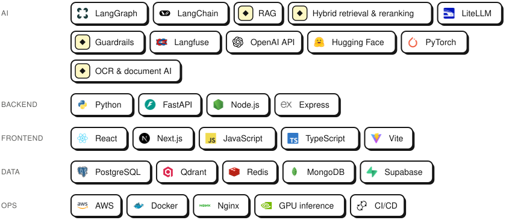

<picture>
  <source media="(prefers-color-scheme: dark)" srcset="assets/header-dark.svg">
  
</picture>

  
  

I build AI products end to end: the agent, the retrieval it answers from, the API it runs on and the screen people use. Two-plus years of shipping them for international clients, mostly in Python and TypeScript.

### Right now

- **At Credentech Solutions**, building Credentra Agents: AI agents a business sets up once and runs on its website, a chat page and WhatsApp.
- **On the side**, an AI tutor for CBSE schools (freelance, in progress).

### Stack

<picture>
  <source media="(prefers-color-scheme: dark)" srcset="assets/stack-dark.svg">
  
</picture>

### Selected work

- **[Credentra Agents](https://portfolio-theta-sandy-69.vercel.app/work/credentra)**: B2B AI agent builder. ~90% grounded answers in ~2s; a reranker lifted hit@1 from 0.77 to 0.95.
- **[APB Bank KYC OCR](https://portfolio-theta-sandy-69.vercel.app/work/apb-kyc-ocr)**: reads Lao ID documents for a bank's digital KYC. ~95% field accuracy, 500+ docs a day, GPU-to-CPU failover.
- **[Taco Bell Thailand invoices](https://portfolio-theta-sandy-69.vercel.app/work/taco-bell-invoice-ocr)**: supplier invoices to accounting data on a self-hosted 2B Thai OCR model. 96% field accuracy, 0 silent errors.
- **[TourExc](https://tourexc.com)**: booking platform for a Thailand travel agency. Live.

Client work, so the code is private. The write-ups are on [my site](https://portfolio-theta-sandy-69.vercel.app).

### Activity

<picture>
  <source media="(prefers-color-scheme: dark)" srcset="profile/snake-dark.svg">
  
</picture>
